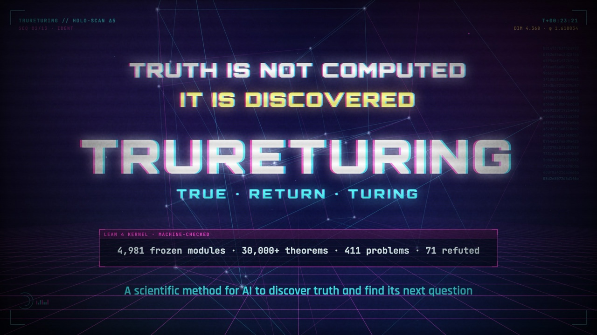

# TRURETURING

**Human intuition, machine rigor, and a research loop that keeps going.**

<a href="https://github.com/the-omega-institute/trureturing-film"></a>

**[trureturing](https://github.com/the-omega-institute/trureturing)** connects mathematical
questions, readable arguments, computation and Lean 4 proofs. Human mathematicians
and AI agents build the library together. Published results retain their sources,
assumptions and exact proof scope, so others can inspect them and take the next step.

> **Question → explore with AI → check in Lean → keep → feedback from mathematicians → next question**

**[Explore the research library](https://www.trureturing.org/)** ·
[Read the book](https://the-omega-institute.github.io/trureturing-mdbook/) ·
[Vision](https://github.com/the-omega-institute/trureturing/blob/dev/docs/VISION.md) ·
[Watch the films](https://github.com/the-omega-institute/trureturing-film)

<!-- BEGIN AUTOMATIC RESEARCH -->
<!-- source_commit=687878cf845802aba2692eeb304cb960d1306431 release_digest=sha256:3a39ce821b5404a44279e0845476c8093bcd9f4434f3801d9a045877d6de8f4b -->

## Recent publications

- **2026-11** · [Subadditivity and the failure of strong subadditivity in the Nichols--Wootters family of entropies](https://arxiv.org/abs/2611.15431)
- **2026-11** · [Meta-Nested Recurrences](https://arxiv.org/abs/2611.15815)
- **2026-11** · [Counting formulas and refined generating functions for inversion-sequence Classes 152 and 207](https://arxiv.org/abs/2611.21657)
- **2026-11** · [Time-invariant negativity and persistent bound entanglement in a cyclic two-qutrit family](https://arxiv.org/abs/2611.04568)
- **2026-11** · [Approximation of a continuous-variable Gaussian state by discrete-variable quantum states](https://arxiv.org/abs/2610.05623)
- **2026-11** · [Well-Covered Powers: Cartesian Products and Cayley Graphs](https://arxiv.org/abs/2611.03956)
- **2026-10** · [Maximal input entropy for binary two-deletion and two-insertion channels](https://arxiv.org/abs/2611.01064)
- **2026-10** · [Block-exchange descent for insertion: commuting projections and minimum masks](https://arxiv.org/abs/2610.39941)
- **2026-10** · [Residue Sums Modulo Products of Two Distinct Odd Primes](https://arxiv.org/abs/2610.29608)
- **2026-10** · [Sharp zero forcing numbers for the generalized Petersen graphs P(n,3) and P(n,4)](https://arxiv.org/abs/2610.24059)
- **2026-10** · [Generation by lazy and invertible cellular automata over the Klein four-group](https://arxiv.org/abs/2610.20329)
- **2026-10** · [On the coincidence of discrete and continuous definitions of Entanglement of Formation](https://arxiv.org/abs/2610.18816)
- **2026-09** · [A Padovan-automatic description of a nested recurrence](https://arxiv.org/abs/2609.33421)
- **2026-09** · [Sub-quorum colorings of graphs](https://arxiv.org/abs/2609.25128)
- **2026-09** · [Generalized Fidelity, the Data Processing Inequality, and Convexity](https://arxiv.org/abs/2609.09753)
- **2026-09** · [A Certificate-Producing Cascade for Equational Implication: The SAIR EQT2 Stage 2 Solver](https://arxiv.org/abs/2609.00706)
- **2026-09** · [Cross-Engine Admission Contracts for Autonomous Formalization](https://openreview.net/forum?id=xOAZvprLXO)
- **2026-08** · [Canonical Zeckendorf Normalization and sharp iteration depth of the Berstel Adder](https://www.rairo-ita.org/articles/ita/abs/2026/01/ita20260032/ita20260032.html)
- **2026-07** · [Mechanism-level routing failure in LLMs over Lean-verified algebraic structures](https://arxiv.org/abs/2607.04534)

[All publications](https://www.trureturing.org/research.html#publications)

## Selected results

### Hiai–Ruskai Conjecture 6.3: exact qubit CQ contraction coefficients

We establish all three exact contraction coefficients for the stated family of qubit channels: dual Wigner–Yanase, geometric and Bogoliubov–Kubo–Mori.

Hiai and Ruskai proposed three optimal bounds in their 2015 preprint. The question asks whether each bound is attained when all admissible states and tangent directions are considered.

This resolves the three metrics in Conjecture 6.3. A formula for every kernel in the broader metric class remains outside this result.

[Read the result](https://www.trureturing.org/conjectures.html#resolved-hiai-ruskai-2015-cq-contraction-coefficients) · [Lean source](https://github.com/the-omega-institute/trureturing/blob/687878cf845802aba2692eeb304cb960d1306431/D5/S3/Quantum/QuantumChannels/HiaiRuskaiRiemannianContraction.lean) · [Original question](https://doi.org/10.1063/1.4936215)

### Erdős–Nicolas reciprocal divisor differences

We prove that for n &gt; 5040, we have Ĥ(n) &lt; τ(n).

No restriction on the order of prime exponents, a divisor-count cutoff, or an unevaluated certificate proposition remains in the theorem's assumptions. The strengthened induction tracks the exceptional integers themselves.

[Read the result](https://www.trureturing.org/conjectures.html#resolved-erdos-nicolas-1989-divisor-difference-sum) · [Lean source](https://github.com/the-omega-institute/trureturing/blob/687878cf845802aba2692eeb304cb960d1306431/D5/S3/Arith/Divisors/ErdosNicolas/Main.lean) · [Original question](https://oeis.org/A330076)

### Essentially Hermitian off-diagonal blocks

Every complex matrix satisfying the proposed bound for all positive block completions is essentially Hermitian: it is an affine complex transform of a Hermitian matrix.

Bourin and Lee posed this question in 2021. It connects a norm inequality to the geometry of a matrix, and includes an earlier normality question of Hayashi.

The result gives a structural implication for the operator norm. An algorithm producing violating completions and extensions to other norms remain open.

[Read the result](https://www.trureturing.org/conjectures.html#resolved-bourin-lee-2021-essentially-hermitian-block-norm) · [Lean source](https://github.com/the-omega-institute/trureturing/blob/687878cf845802aba2692eeb304cb960d1306431/D5/S3/Quantum/BlockNorm/EssentiallyHermitian.lean) · [Original question](https://doi.org/10.1142/S0129167X22500094)

[Explore all results](https://www.trureturing.org/conjectures.html#results)

## Published research snapshot

**2,235 resolution records** in the current verified release: **1,477 proved** and **758 refuted**. **19 publication records** in the public research catalog.

Each result links its exact statement, assumptions and proof source. Explore the [research library](https://www.trureturing.org/) to find a question to work on.

<!-- END AUTOMATIC RESEARCH -->

## Bring a question

Bring a question, an idea, a model, or an agent. Make one step precise, and give
someone else a place to start. [Open an issue](https://github.com/the-omega-institute/trureturing/issues),
read the [contribution guide](https://github.com/the-omega-institute/trureturing/blob/dev/docs/CONTRIBUTING.md),
or paste this into Claude Code or Codex:

```text
Help me explore https://github.com/the-omega-institute/trureturing: use an existing checkout or clone it into a new directory if needed, read AGENTS.md and README.md, then read the relevant SKILL.md under skills/ to investigate a question I care about and find a checked result or a clearly stated open question.
```

## Part of [Chrono AI](https://www.chrono-ai.fun/)
